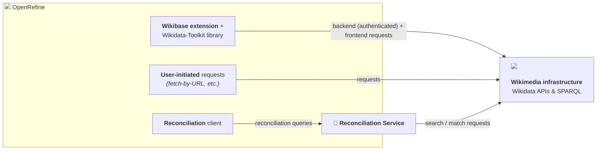

Since 2018, Wikidata has been the default reconciliation service packaged with OpenRefine and plays a critical role in many workflows. According to our [2024 user survey](https://openrefine.org/blog/2024/12/20/2024-survey-results), a significant portion of users rely on it: 25% identify as Wikimedians, and 44% use the Wikidata reconciliation service.

Reconciliation has been part of OpenRefine’s purpose since [its origins as a companion tool to Freebase](/openrefine_history), and OpenRefine remains one of the few general-purpose tools that provides a dedicated reconciliation interface. **However, OpenRefine neither operates nor maintains the Wikidata reconciliation service.**

This post clarifies OpenRefine's relationship with reconciliation services in general and, in particular, how OpenRefine integrates with the Wikidata reconciliation ecosystem.

<!--truncate-->

## OpenRefine as a client of reconciliation services

OpenRefine is a **client of the reconciliation protocol** and can connect to many different [reconciliation services](https://openrefine.org/extensions#reconciliation-services). Wikidata is one of them, and more than 30 services were identified in our 2024 user survey. 

OpenRefine provides the user interface, data transformation tools, and the ability to connect to reconciliation services. Each service provider, however, is responsible for configuring how its endpoint connects to and searches the underlying data, including ranking, scoring, and candidate selection.

Operating a production reconciliation service also requires infrastructure, monitoring, and ongoing maintenance, which are outside the scope of a desktop application like OpenRefine. When a user sends data for reconciliation, those queries are sent to the selected reconciliation service. They depend on that service provider's infrastructure and availability and are subject to its terms of service and data-handling policies. OpenRefine does not control those external services or the underlying data sources they access.

## Wikidata reconciliation structure

The Wikidata reconciliation stack involves several independently maintained components, each with its own scope, infrastructure, and maintenance responsibilities.

### Core components of the Wikidata reconciliation stack

| Component | Role | Project links |
| --- | --- | --- |
| **[OpenRefine](https://openrefine.org/)** Operated and maintained by the OpenRefine project | Desktop client that provides the reconciliation interface and sends queries to configured reconciliation services. It also interacts directly with Wikidata/Wikibase for some operations. | [GitHub repository](https://github.com/OpenRefine/OpenRefine) |
| **[Wikidata Toolkit](https://www.mediawiki.org/wiki/Wikidata_Toolkit)** Maintained independently from OpenRefine | Java library used by OpenRefine's Wikibase integration for some direct interactions with Wikidata and other Wikibase instances. | [GitHub repository](https://github.com/Wikidata/Wikidata-Toolkit) |
| **[Wikidata reconciliation service](https://wikidata-reconciliation.wmcloud.org/)** Maintained by the Wikibase reconciliation service maintainers and hosted on Wikimedia Cloud VPS | Deployment of the Wikibase reconciliation service configured for Wikidata. It receives reconciliation queries from clients such as OpenRefine and queries Wikidata to return candidates. | [Wikimedia GitLab](https://gitlab.wikimedia.org/repos/wikibase-reconciliation) & [Issue tracker](https://phabricator.wikimedia.org/project/profile/5458/) |
| **[Wikidata](https://www.wikidata.org/wiki/Wikidata:Main_Page) APIs and [Wikidata Query Service](https://query.wikidata.org/)** Operated as part of Wikimedia infrastructure | Wikimedia data and query infrastructure used by the reconciliation service and, for some operations, directly by OpenRefine. | [Data access documentation](https://www.wikidata.org/wiki/Wikidata:Data_access) |

### How the components interact

## In practice

OpenRefine's close integration with Wikidata does not mean that the two projects, or the services between them, share the same ownership or operational responsibilities. OpenRefine provides the client interface and integrates the Wikidata reconciliation endpoint by default, while the reconciliation service and the Wikimedia infrastructure it depends on are maintained separately.

These boundaries matter when troubleshooting problems or reporting issues. Problems with OpenRefine's reconciliation interface should be reported to the [OpenRefine issue tracker](https://github.com/OpenRefine/OpenRefine/issues), while problems with the Wikidata reconciliation endpoint or its availability should be reported to the [reconciliation service maintainers](https://phabricator.wikimedia.org/project/profile/5458/). Understanding these boundaries also helps users identify where their data is sent and which service provider's infrastructure, terms of service, and data-handling policies apply.
